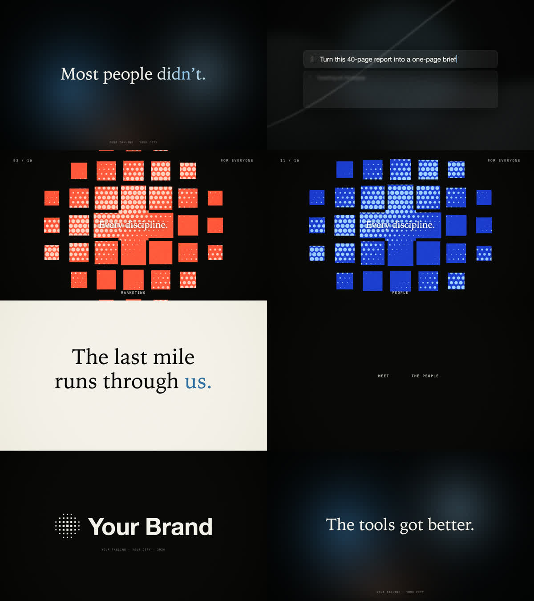

# launch-video

A Claude Code skill for making short, premium brand intros and launch videos entirely in code, in the style of the AI launch films that circulate on X and LinkedIn.



It started as a 24-second intro for a student AI club. The first attempt was fine but generic. The second one went much better because of three changes, and those three changes are what this skill packages:

1. **References before design.** 11 real launch films (Claude Opus 5.5, Raycast, Lovable 2.0, ElevenLabs v3, Linear, Notion, Cursor, Perplexity Comet and others) were downloaded and broken down shot by shot. The result is [`STYLE.md`](skills/launch-video/STYLE.md): cut rates, structure, type and colour, and 12 techniques ranked, each with how to build it in HTML/CSS/canvas.
2. **Music first, edit second.** Generate the track, measure its real BPM and drop, then put every scene change on the beat.
3. **Code renders every frame.** Scenes are a single HTML page with a deterministic `render(t)`, captured frame-exactly by headless Chrome and encoded with ffmpeg. That means no timeline editor and no dropped frames, and every change is a one-line edit.

## What's inside

```
skills/launch-video/
├── SKILL.md            the workflow Claude follows
├── STYLE.md            the reference study + ranked techniques
├── template/
│   ├── intro.html      working 24 s / 120 BPM intro (edit COPY + SHOTS)
│   ├── render.mjs      headless Chrome -> ffmpeg, no npm deps
│   └── add_audio.sh    music + SFX mix
├── scripts/
│   ├── gen_music.sh    ElevenLabs music
│   ├── gen_sfx.sh      ElevenLabs sound effects
│   ├── beats.py        BPM + beat offset
│   └── energy.py       loudness map (find the drop)
└── prompts/            the music and SFX prompts that worked
```

The template's scenes, all timed to the beat, each borrowed from a reference:

| Time | Scene | Borrowed from |
|---|---|---|
| 0-4 s | Grainy mesh gradient, words blur in, one accent word | ElevenLabs, Lovable |
| 4-8 s | Glass prompt bar arrives huge, pulls back, types, tasks tick off, camera pushes through | Raycast, Notion |
| 8-14 s | Fixed mark as a window; the material behind it changes every beat, then every half-beat | Claude Opus 5.5 |
| 14-17 s | Inversion to paper, the statement line | ElevenLabs, Comet |
| 17-20.5 s | Tiny mono caps on black, one per beat | Raycast |
| 20.5-24 s | Dots fly in and form the mark, then the name | Lovable, Comet |

## Install

As a plugin:

```
/plugin marketplace add Hagetino/launch-video
/plugin install launch-video@launch-video
```

Or manually: copy `skills/launch-video` into `~/.claude/skills/`.

Then just ask Claude Code for it, e.g. *"make a 20-second launch video for our hackathon"*.

## Requirements

- Google Chrome (on Linux/Windows set `CHROME=/path/to/chrome`)
- Node.js 22+ (uses the built-in `WebSocket`)
- ffmpeg, python3
- Optional: an [ElevenLabs](https://elevenlabs.io) API key in `ELEVENLABS_API_KEY` for music and SFX. Any track you have the rights to works too.

## Use the template by hand

```bash
cp -r skills/launch-video/template my-intro && cd my-intro
open intro.html                                   # live preview in the browser
# edit COPY / SHOTS at the top of the <script>, swap fonts, colours and logo

mkdir -p audio
ELEVENLABS_API_KEY=... ../skills/launch-video/scripts/gen_music.sh audio/music.mp3 24
python3 ../skills/launch-video/scripts/beats.py audio/music.mp3   # retime scenes to the real beats

node render.mjs stills 1.5,6.9,9.2,15.8,23   # check the key frames
node render.mjs video intro-silent.mp4       # ~1 min
./add_audio.sh                               # -> intro.mp4
```

## Notes

- The reference films belong to their makers. `STYLE.md` only describes them and links the public videos; nothing from them is included here.
- Generated music and SFX follow ElevenLabs' terms for your plan. Check commercial use before you publish.
- Pairs well with [reel-to-action](https://github.com/Hagetino/reel-to-action), which downloads and breaks down any reference video you want to study.

## License

MIT
